# Multi-Tenant Asset & Inventory Management — Mermaid ERD

This schema supports:
* **Multi-tenancy** (`organizations` + `organization_id` isolation across all tenant tables)
* **Invite-only Auth, Sessions & RBAC** (`users`, `invitations`, `sessions`, `roles`, `permissions`, `role_permissions`, `user_roles`)
* **Localization (`i18n`)** via `JSONB` columns (`name_i18n`, `description_i18n`) on catalog & lookup tables
* **4 Inventory Pillars**: Serialized Assets (`products` + `assets`), Accessories, Consumables, and Software Licenses
* **Operations & Compliance**: SIM cards, Maintenances/Repairs, Polymorphic Attachments, and Audit Logs

```mermaid
erDiagram
    %% ==========================================
    %% 1. MULTI-TENANCY, INVITE-ONLY AUTH & RBAC
    %% ==========================================
    organizations {
        uuid id PK
        varchar name
        varchar slug UK
        varchar default_locale
        jsonb settings
        timestamptz created_at
    }

    users {
        uuid id PK
        uuid organization_id FK
        varchar full_name
        varchar email UK
        varchar password_hash
        varchar preferred_locale
        varchar status "active | suspended | deactivated"
        uuid department_id FK "nullable"
        timestamptz last_login_at
        timestamptz created_at
    }

    invitations {
        uuid id PK
        uuid organization_id FK
        varchar email
        uuid role_id FK
        uuid invited_by_user_id FK
        varchar token_hash UK
        varchar status "pending | accepted | expired | revoked"
        timestamptz expires_at
        timestamptz accepted_at
        timestamptz created_at
    }

    sessions {
        uuid id PK
        uuid user_id FK
        uuid organization_id FK
        varchar token_hash UK
        varchar ip_address
        text user_agent
        timestamptz expires_at
        timestamptz revoked_at
        timestamptz created_at
    }

    roles {
        uuid id PK
        uuid organization_id FK
        varchar name
        varchar slug
        boolean is_system
        timestamptz created_at
    }

    permissions {
        uuid id PK
        varchar code UK "e.g. assets.create, licenses.assign"
        varchar module "assets | accessories | consumables | licenses | users | admin"
        text description
    }

    role_permissions {
        uuid role_id PK, FK
        uuid permission_id PK, FK
    }

    user_roles {
        uuid user_id PK, FK
        uuid role_id PK, FK
    }

    %% ==========================================
    %% 2. SHARED LOOKUPS & HIERARCHY (i18n)
    %% ==========================================
    departments {
        uuid id PK
        uuid organization_id FK
        jsonb name_i18n
        uuid parent_department_id FK "nullable"
    }

    locations {
        uuid id PK
        uuid organization_id FK
        jsonb name_i18n
        varchar address
        uuid parent_location_id FK "nullable"
    }

    brands {
        uuid id PK
        uuid organization_id FK
        varchar name "Samsung, Huawei, Apple, Microsoft"
        varchar support_url
    }

    categories {
        uuid id PK
        uuid organization_id FK
        jsonb name_i18n
        varchar item_type "asset | accessory | consumable | license"
    }

    vendors {
        uuid id PK
        uuid organization_id FK
        varchar name
        varchar contact_email
        varchar phone
    }

    %% ==========================================
    %% 3. PILLAR A: SERIALIZED ASSETS & SIMS
    %% ==========================================
    products {
        uuid id PK
        uuid organization_id FK
        uuid brand_id FK
        uuid category_id FK
        jsonb name_i18n
        jsonb description_i18n
        varchar model_code "e.g. SM-S928B"
        jsonb specs_json "os, ram_gb, storage_gb, dual_sim"
        int default_warranty_months
        timestamptz created_at
    }

    assets {
        uuid id PK
        uuid organization_id FK
        uuid product_id FK
        uuid location_id FK
        uuid assigned_to_user_id FK "nullable"
        uuid vendor_id FK "nullable"
        varchar asset_tag
        varchar serial_number "nullable"
        varchar status "in_stock | assigned | in_repair | retired | lost"
        varchar condition "new | good | fair | damaged"
        date purchase_date
        decimal purchase_cost
        date warranty_expires_at
        timestamptz created_at
        timestamptz deleted_at "nullable"
    }

    asset_assignments {
        uuid id PK
        uuid organization_id FK
        uuid asset_id FK
        uuid user_id FK
        uuid assigned_by_user_id FK
        timestamptz assigned_at
        timestamptz returned_at "nullable"
        text notes
    }

    sim_cards {
        uuid id PK
        uuid organization_id FK
        uuid assigned_asset_id FK "nullable"
        uuid assigned_user_id FK "nullable"
        varchar iccid
        varchar phone_number
        varchar carrier
        varchar plan_name
        varchar pin_code "nullable"
        varchar puk_code "nullable"
        varchar status "active | in_stock | suspended | deactivated"
    }

    asset_maintenances {
        uuid id PK
        uuid organization_id FK
        uuid asset_id FK
        uuid vendor_id FK "nullable"
        varchar maintenance_type "repair | warranty_claim | inspection"
        varchar status "scheduled | in_progress | completed | cancelled"
        text issue_description
        decimal cost
        timestamptz started_at
        timestamptz completed_at "nullable"
    }

    %% ==========================================
    %% 4. PILLAR B: ACCESSORIES
    %% ==========================================
    accessories {
        uuid id PK
        uuid organization_id FK
        uuid brand_id FK "nullable"
        uuid category_id FK
        uuid location_id FK
        jsonb name_i18n
        int total_quantity
        int available_quantity
        int min_stock_alert
        decimal unit_cost
    }

    accessory_assignments {
        uuid id PK
        uuid organization_id FK
        uuid accessory_id FK
        uuid assigned_to_user_id FK "nullable"
        uuid assigned_to_asset_id FK "nullable"
        int quantity
        timestamptz assigned_at
        timestamptz returned_at "nullable"
        uuid assigned_by_user_id FK "nullable"
        text notes "nullable"
    }

    %% ==========================================
    %% 5. PILLAR C: CONSUMABLES
    %% ==========================================
    consumables {
        uuid id PK
        uuid organization_id FK
        uuid brand_id FK "nullable"
        uuid category_id FK
        uuid location_id FK
        jsonb name_i18n
        varchar sku "nullable"
        int quantity_on_hand
        int min_stock_alert
        varchar unit_of_measure
        decimal unit_cost
    }

    consumable_transactions {
        uuid id PK
        uuid organization_id FK
        uuid consumable_id FK
        varchar transaction_type "restock | issue | adjustment"
        int quantity_change
        uuid issued_to_user_id FK "nullable"
        uuid issued_to_asset_id FK "nullable"
        uuid performed_by_user_id FK
        text notes "nullable"
        timestamptz created_at
    }

    %% ==========================================
    %% 6. PILLAR D: SOFTWARE LICENSES
    %% ==========================================
    licenses {
        uuid id PK
        uuid organization_id FK
        uuid brand_id FK "nullable"
        uuid vendor_id FK "nullable"
        uuid category_id FK
        jsonb name_i18n
        text license_key "nullable"
        varchar license_type "subscription | perpetual | volume"
        int total_seats
        date purchase_date
        date expires_at "nullable"
        decimal cost
    }

    license_seats {
        uuid id PK
        uuid organization_id FK
        uuid license_id FK
        uuid assigned_to_user_id FK "nullable"
        uuid assigned_to_asset_id FK "nullable"
        varchar seat_key "nullable"
        timestamptz assigned_at
        timestamptz revoked_at "nullable"
        text notes "nullable"
    }

    %% ==========================================
    %% 7. ATTACHMENTS & AUDIT LOGS
    %% ==========================================
    attachments {
        uuid id PK
        uuid organization_id FK
        varchar entity_type "asset | maintenance | license | user | product"
        uuid entity_id
        varchar file_name
        varchar file_url
        varchar mime_type
        bigint file_size_bytes
        uuid uploaded_by_user_id FK
        timestamptz created_at
    }

    audit_logs {
        uuid id PK
        uuid organization_id FK
        uuid actor_user_id FK "nullable"
        varchar action "created | updated | deleted | assigned | returned | login"
        varchar entity_type
        uuid entity_id
        jsonb old_values
        jsonb new_values
        varchar ip_address
        timestamptz created_at
    }

    %% ==========================================
    %% RELATIONSHIPS
    %% ==========================================
    organizations ||--o{ users : "has"
    organizations ||--o{ invitations : "issues"
    organizations ||--o{ roles : "defines"
    organizations ||--o{ departments : "contains"
    organizations ||--o{ locations : "contains"
    organizations ||--o{ brands : "owns"
    organizations ||--o{ categories : "owns"
    organizations ||--o{ vendors : "owns"
    organizations ||--o{ products : "owns"
    organizations ||--o{ assets : "owns"
    organizations ||--o{ sim_cards : "owns"
    organizations ||--o{ accessories : "owns"
    organizations ||--o{ consumables : "owns"
    organizations ||--o{ licenses : "owns"
    organizations ||--o{ attachments : "stores"
    organizations ||--o{ audit_logs : "records"

    users ||--o{ sessions : "authenticates"
    users ||--o{ user_roles : "assigned"
    roles ||--o{ user_roles : "granted_to"
    roles ||--o{ role_permissions : "includes"
    permissions ||--o{ role_permissions : "mapped_in"
    roles ||--o{ invitations : "pre_assigns"
    users ||--o{ invitations : "sends"

    departments ||--o{ users : "employs"
    departments ||--o{ departments : "parent_of"
    locations ||--o{ locations : "parent_of"

    brands ||--o{ products : "manufactures"
    categories ||--o{ products : "classifies"
    products ||--o{ assets : "defines_model"
    locations ||--o{ assets : "houses"
    vendors ||--o{ assets : "supplies"
    users ||--o{ assets : "custodian_of"

    assets ||--o{ asset_assignments : "history"
    users ||--o{ asset_assignments : "receives"
    assets ||--o{ sim_cards : "holds"
    users ||--o{ sim_cards : "assigned_line"
    assets ||--o{ asset_maintenances : "undergoes"
    vendors ||--o{ asset_maintenances : "services"

    brands ||--o{ accessories : "makes"
    categories ||--o{ accessories : "classifies"
    locations ||--o{ accessories : "stores"
    accessories ||--o{ accessory_assignments : "allocated_via"
    users ||--o{ accessory_assignments : "receives"
    assets ||--o{ accessory_assignments : "paired_with"

    brands ||--o{ consumables : "makes"
    categories ||--o{ consumables : "classifies"
    locations ||--o{ consumables : "stores"
    consumables ||--o{ consumable_transactions : "tracked_by"
    users ||--o{ consumable_transactions : "issued_to"
    assets ||--o{ consumable_transactions : "used_on"

    brands ||--o{ licenses : "publishes"
    vendors ||--o{ licenses : "resells"
    categories ||--o{ licenses : "classifies"
    licenses ||--o{ license_seats : "allocates"
    users ||--o{ license_seats : "uses"
    assets ||--o{ license_seats : "installed_on"

    users ||--o{ attachments : "uploads"
    users ||--o{ audit_logs : "performs"
```

---

## Milestone 1 implementation notes

The SQL under `migrations/` is authoritative. The ERD above is kept as the
conceptual map; these are the concrete choices made while implementing M1.

- **Audit columns:** every mutable table has `created_at`, `updated_at`
  (`NOT NULL DEFAULT now()`) and `deleted_at` (nullable). Exempt by rule:
  `sessions`, `audit_logs`, `role_permissions`, `user_roles`,
  `consumable_transactions`.
- **Tenant columns:** `role_permissions` and `user_roles` have no
  `organization_id`; tenant isolation is enforced through their parent rows.
  `permissions` is a global catalog.
- **Locales:** `organizations.default_locale` and `users.preferred_locale`
  are `varchar(2)` with `CHECK (... IN ('en','fr','ar'))`.
  `organizations.currency` is `char(3) NOT NULL DEFAULT 'DZD'`.
- **Email uniqueness:** `users.email` is globally unique (case-insensitive,
  partial on `deleted_at IS NULL`) because login accepts email only.
  Pending invitations are unique per `(organization_id, lower(email))`.
- **Soft-delete uniqueness:** tenant-scoped unique indexes ignore
  `deleted_at IS NOT NULL` rows so a tag/SKU/IMEI can be reused after deletion.
- **Open assignments:** one open `asset_assignments` row per asset
  (`returned_at IS NULL`); one open `license_seats` row per license+user and
  license+asset (`revoked_at IS NULL`); one open SIM per asset
  (`assigned_asset_id IS NOT NULL`).
- **License seats:** a seat may be unassigned; the target check is
  `num_nonnulls(user, asset) <= 1`.
- **Audit attribution:** `audit_logs.organization_id` stays `NOT NULL`.
  `login_failed` is therefore audit-logged only when the email matches an
  existing user; unknown emails cannot be attributed to a tenant.
- **Status changes:** `PATCH /users/{id}` requires `users.update`, and
  additionally `users.deactivate` when moving a user to `suspended` or
  `deactivated`.

## Milestone 2 implementation notes

- **No table/column changes.** M2 only adds permission rows/role mappings and
  the uniqueness indexes listed below.
- **Unique indexes:** `products (organization_id, lower(model_code))`,
  `categories (organization_id, item_type, lower(name_i18n->>'en'))`,
  `vendors (organization_id, lower(name))`, and
  `locations`/`departments` on
  `(organization_id, COALESCE(parent_id, '000…000'::uuid), lower(name_i18n->>'en'))`.
  All are partial on `deleted_at IS NULL` and replace the plain M1 products
  index.
- **i18n reads:** resolved name = `preferred_locale` → `default_locale` →
  `en` → first non-empty key. Raw `name_i18n` is still returned alongside the
  resolved `name`.
- **Asset custody:** `assets.assigned_to_user_id` mirrors the open
  `asset_assignments` row (`returned_at IS NULL`). `/assign` and `/return`
  update both atomically; PATCH closes an open assignment only when a status
  change moves the asset out of `assigned`.
- **Transfer:** allowed only from `in_stock`; assigned assets must be returned
  first, per the status state machine.
- **Labels:** QR payload is `ASSET_QR_BASE_URL` + `/assets/{id}`; `/label.svg`
  is deterministic and contains no timestamps or user data.

## Milestone 3 implementation notes

- **Additive columns only:** `accessory_assignments.assigned_by_user_id`,
  `accessory_assignments.notes`, `consumable_transactions.notes`, and
  `license_seats.notes`. No existing column changed type.
- **Accessory open-assignment uniqueness:** M1 shipped only the non-unique
  `accessory_assignments_open_idx`. M3 adds
  `accessory_assignments_open_pair_uniq` on
  `(accessory_id, COALESCE(user,'000…000'), COALESCE(asset,'000…000'))`
  where `returned_at IS NULL AND deleted_at IS NULL`, so multiple users may
  hold the same accessory while each pair keeps one open row.
- **Accessory stock invariant:** `SUM(open assignment quantity) +
  available_quantity = total_quantity`. Partial returns close the current row
  at the returned quantity and insert a remainder row for the same target.
- **Consumable stock:** `quantity_on_hand` changes only through
  `POST /consumables/{id}/transactions`; PATCH cannot touch it.
- **License seats:** allocation is serialized with `SELECT … FOR UPDATE` on
  the license row; `active_seats` is counted at read time. No triggers.
